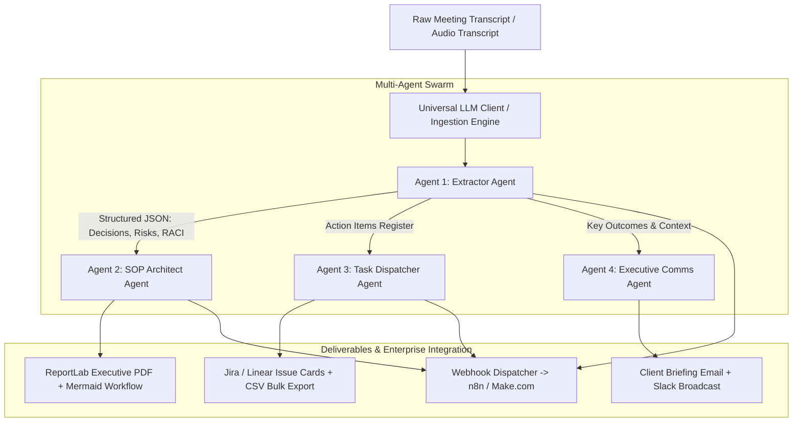

# ⚡ SyncOps AI: Autonomous Enterprise Meeting-to-SOP & Workflow Orchestration Agent

> **Built for Enterprise AI Transformation & B2B Operations.**  
> Translates messy meeting transcripts, Zoom audio, and stakeholder syncs into publication-grade Standard Operating Procedures (SOPs), Jira/Linear ticket backlogs, and C-Suite executive briefings with zero hallucination.

---

## 📌 Executive Summary & Business Problem

In enterprise environments, cross-functional meetings (client onboarding, incident postmortems, architecture reviews) consume thousands of hours, yet critical decisions and action items often get lost in messy notes. 
Manual synthesis takes an average of **3 to 5 hours per meeting** to write documentation, file tickets in Jira, draft stakeholder emails, and build compliance procedures.

**SyncOps AI** automates this end-to-end pipeline through a coordinated swarm of 4 specialized AI agents, reducing post-meeting administrative turnaround from **hours to under 2 seconds**.

---

## 🏗️ Architecture & Multi-Agent Swarm

---

## 🤖 Specialized Agent Swarm Breakdown

| Agent | Core Mandate | Output Deliverable |
| :--- | :--- | :--- |
| **1. Extractor Agent** | Synthesizes chaotic transcripts into deterministic JSON schemas. Filters noise and isolates binding agreements. | Decisions, Action Items, Risk Registry, RACI Governance Matrix. |
| **2. SOP Architect** | Translates operational requirements into formal enterprise compliance SOPs with delivery gates. | Formatted Markdown SOP, Executive PDF document, and Mermaid workflow diagrams. |
| **3. Task Dispatcher** | Converts commitments into engineering backlog issues with strict acceptance criteria and ownership tags. | Interactive Jira/Linear issue cards + downloadable CSV import file. |
| **4. Executive Comms** | Bridges technical execution and C-level stakeholder reporting with tailored tonality. | Copy-paste Client Briefing Email & formatted Slack/Teams broadcast message. |

---

## 🚀 Key Features

* **Zero-Hallucination Schema Enforcement:** Guarantees that every task has a designated owner, priority level, and verifiable completion criteria.
* **Dual Execution Modes:**
  * **🌟 Smart Offline Engine:** 100% deterministic, zero external API key required—ideal for instant offline evaluation or live stage presentations.
  * **☁️ Cloud API Integration:** Supports Google Gemini API (`gemini-1.5-flash`, `gemini-2.0-flash`) and OpenAI API (`gpt-4o-mini`).
* **Publication-Grade PDF Generation:** Built-in PDF compiler utilizing `ReportLab` to produce clean, executive-styled documentation ready for corporate distribution.
* **One-Click Jira/Linear CSV Export:** Immediately loadable into enterprise issue tracking software.
* **Preloaded Enterprise Scenarios:**
  1. *B2B Enterprise SaaS Client Onboarding (Fintech + CloudSync)*
  2. *Critical Production Incident Postmortem (INC-8902 Database Connection Saturation)*
  3. *Q1 AI Copilot & Customer Support Automation Strategy*

