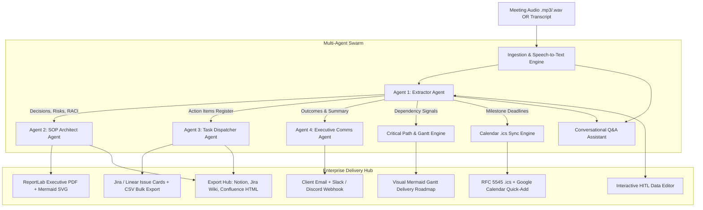

# ⚡ SyncOps AI: Autonomous Enterprise Meeting-to-SOP & Workflow Orchestration Swarm

[](https://github.com/aakritishakya9/Enterprise-Ops-Agent-Workflow-Automator/actions)
[](https://www.python.org/downloads/)
[](https://streamlit.io/)
[](#architecture)
[](LICENSE)

> **Enterprise AI Transformation & B2B Operations Platform.**  
> Translates unstructured meeting audio, Zoom recordings, and stakeholder transcripts into binding Standard Operating Procedures (SOPs), Jira ticket backlogs, interactive Gantt roadmaps, and calendar events with zero hallucination.

---

## 📌 Executive Summary & Business Problem

In enterprise environments, cross-functional meetings (client onboarding, incident postmortems, architecture reviews) consume thousands of hours, yet critical decisions and action items often get lost in notes. 
Manual synthesis takes an average of **3 to 5 hours per meeting** to write documentation, file tickets in Jira, draft stakeholder emails, and build compliance procedures.

**SyncOps AI** automates this end-to-end pipeline through a coordinated swarm of specialized AI agents, reducing post-meeting administrative turnaround from **hours to under 2 seconds** while calculating real-time ROI metrics for executive leadership.

---

## 🏗️ Architecture & Multi-Agent Swarm



---

## 🚀 Key Platform Features (v2.6)

### 1. 💬 "Chat with the Meeting" (Conversational Q&A Assistant)
* Direct conversational interaction with the processed meeting dialogue.
* Ask questions like *"What did Marcus say about static IPs?"* or *"What are the critical blockers?"* to receive grounded answers with exact transcript timestamp citations.

### 2. 📅 1-Click Calendar & Deadline Sync (`.ics` / Google Calendar)
* Exports binding deadlines into standard **RFC 5545 `.ics` iCalendar** files compatible with Google Calendar, Microsoft Outlook, and Apple Calendar.
* Generates one-click direct Google Calendar event creation links for every action item.

### 3. ⏳ Task Dependency Graph & Critical Path Analysis
* Analyzes prerequisite relationships between tasks to identify blockers and the **Critical Path**.
* Computes a **Parallelizability Concurrency Score** and renders both a **Mermaid Gantt Chart** and a **Dependency Network Flowchart**.

### 4. 📋 Multi-Platform Export Hub (Notion, Jira, Confluence)
* Native one-click copy formats tailored for enterprise tools:
  * **Notion:** Markdown with callout alerts and collapsible `<details>` toggles.
  * **Jira Wiki Markup:** Native Jira format (`h1.`, `||table||`, `{panel}`).
  * **Confluence HTML:** Clean HTML storage format with styled tables and headers.

### 5. 🎙️ Live Microphone Voice & Audio Ingestion
* Direct in-browser microphone recording with speech-to-text transcription.
* Supports drag-and-drop file uploads for `.wav`, `.mp3`, `.m4a` Zoom recordings.

### 6. 🤝 Human-in-the-Loop (HITL) Interactive Data Grid
* Modify action items, assignees, deadlines, and priorities live in `st.data_editor`.
* Click **"💾 Re-Sync All Deliverables with Edits"** to dynamically update downstream SOPs, PDFs, Gantt charts, and tickets.

### 7. 📈 Meeting Efficiency & ROI Scorecard ("Every Person Owns a Number")
* Calculates real-time business yield:
  * **Actionability Index:** Ratio of actionable commitments vs dialogue volume.
  * **Accountability Ratio:** Percentage of tasks with single, named owners vs vague groups.
  * **Financial ROI:** Direct meeting salary costs vs automated admin savings.

### 8. 📄 Publication-Grade PDF Generator (`ReportLab`)
* Compiles formal executive documents with title blocks, RACI tables, and delivery gates ready for C-suite distribution.

---

## 📂 Repository Structure

```
Enterprise-Ops-Agent-Workflow-Automator/
├── .github/
│   └── workflows/
│       └── test.yml            # Automated CI pipeline running tests on push/PR
├── .streamlit/
│   └── config.toml             # Native dark enterprise SaaS theme
├── app.py                      # Multi-agent Streamlit dashboard with 10 enterprise tabs
├── agents/
│   ├── __init__.py
│   ├── extractor.py            # Extraction Agent: Decisions, Actions, Risks, RACI
│   ├── sop_architect.py        # SOP Agent: Structured SOP with Mermaid diagram & checklists
│   ├── task_dispatcher.py      # Task Agent: Jira / Linear / GitHub Markdown tickets + CSV export
│   └── comms_agent.py          # Comms Agent: Executive email & stakeholder briefing
├── core/
│   ├── __init__.py
│   ├── meeting_qa.py           # Conversational Q&A Assistant ("Chat with Meeting")
│   ├── calendar_export.py      # RFC 5545 .ics generator & Google Calendar quick-add URLs
│   ├── dependency_analyzer.py  # Critical Path & Mermaid Gantt dependency analyzer
│   ├── export_formatter.py     # Native Notion, Jira Wiki, and Confluence HTML formatters
│   ├── audio_processor.py      # Audio upload & Speech-to-Text transcription engine
│   ├── roi_analytics.py        # Meeting ROI, Actionability Index & Accountability Scorecard
│   ├── webhook_sender.py       # Live HTTP dispatcher for Slack, Discord, and n8n webhooks
│   ├── llm_client.py           # Universal LLM caller (Gemini API / OpenAI API / Smart Offline Engine)
│   ├── pdf_generator.py        # ReportLab PDF generator for executive-ready SOP docs
│   └── templates.py            # Rich enterprise meeting transcripts (B2B SaaS, Incident, Product Strategy)
├── tests/
│   ├── test_agents.py          # Comprehensive test suite covering all platform modules
├── requirements.txt            # Python dependencies
└── README.md                   # Complete architectural documentation
```

---

## 🛠️ Installation & Quickstart

### 1. Clone & Navigate to Project Directory
```bash
git clone https://github.com/aakritishakya9/Enterprise-Ops-Agent-Workflow-Automator.git
cd Enterprise-Ops-Agent-Workflow-Automator
```

### 2. Install Dependencies
```bash
pip install -r requirements.txt
```

### 3. Run Automated Tests
```bash
python tests/test_agents.py
```
*Expected output: All 9 test modules passing with 100% verification.*

### 4. Launch the Interactive Dashboard
```bash
python -m streamlit run app.py
```
Open your browser at `http://localhost:8501`.

---

## 💡 How to Demo in an Interview (3-Minute Script)

1. **The Hook (30s):**
   > *"In enterprise operations, post-meeting administrative work—writing SOPs, assigning tickets, scheduling deadlines—takes 4+ hours per meeting. I built SyncOps AI: an agentic swarm that takes voice audio or transcripts and generates a complete delivery package in under 2 seconds."*
2. **The Walkthrough (60s):**
   > *"Click 'Run Multi-Agent Orchestration'. You see 4 coordinated agents isolate decisions and build a publication-grade SOP with an SVG process diagram and downloadable PDF. Notice our 4 advanced engines:
   > 1. 'Chat with Meeting' allows you to ask conversational questions with timestamp citations.
   > 2. 'Calendar Sync' generates .ics files and Google Calendar links for each deadline.
   > 3. 'Critical Path' analyzes task dependencies with a visual Mermaid Gantt chart.
   > 4. 'Export Hub' produces one-click native blocks for Notion, Jira Wiki, and Confluence."*
3. **The Impact (30s):**
   > *"It turns passive conversations into structured, executable engineering output with deterministic zero-hallucination compliance."*

---

## 📄 License
MIT License. Developed for applied enterprise AI workflow automation.
