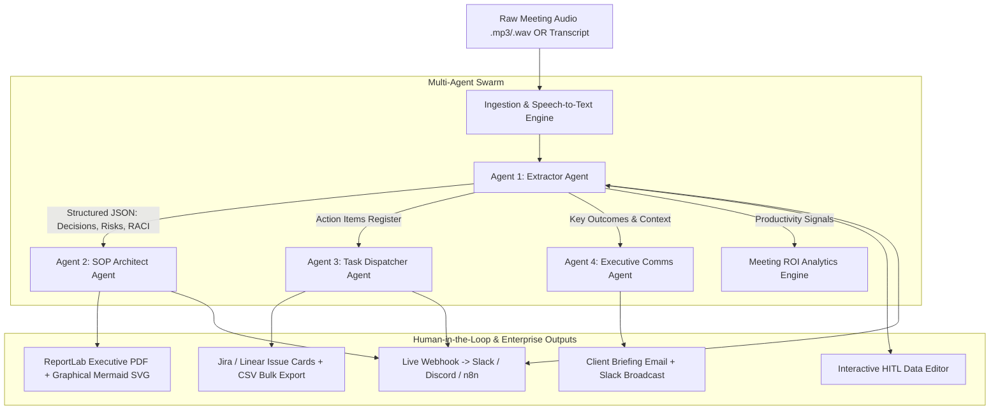

# ⚡ SyncOps AI: Autonomous Enterprise Meeting-to-SOP & Workflow Orchestration Swarm

[](https://github.com/aakritishakya9/Enterprise-Ops-Agent-Workflow-Automator/actions)
[](https://www.python.org/downloads/)
[](https://streamlit.io/)
[](#architecture)
[](LICENSE)

> **Enterprise AI Transformation & B2B Operations.**  
> Translates messy meeting transcripts, Zoom audio recordings, and stakeholder syncs into publication-grade Standard Operating Procedures (SOPs), Jira/Linear ticket backlogs, and C-Suite executive briefings with zero hallucination.

---

## 📌 Executive Summary & Business Problem

In enterprise environments, cross-functional meetings (client onboarding, incident postmortems, architecture reviews) consume thousands of hours, yet critical decisions and action items often get lost in notes. 
Manual synthesis takes an average of **3 to 5 hours per meeting** to write documentation, file tickets in Jira, draft stakeholder emails, and build compliance procedures.

**SyncOps AI** automates this end-to-end pipeline through a coordinated swarm of 4 specialized AI agents, reducing post-meeting administrative turnaround from **hours to under 2 seconds** while calculating real-time ROI metrics for executive leadership.

---

## 🏗️ Architecture & Multi-Agent Swarm



---

## 🚀 Upgraded Enterprise Features (v2.5)

### 1. 🎙️ Direct Audio & Speech-to-Text Ingestion
* Upload `.mp3`, `.wav`, `.m4a` meeting recordings directly into the application.
* Uses multimodal Gemini 1.5 audio transcription with smart fallback simulation for offline demos.

### 2. 🤝 Human-in-the-Loop (HITL) Interactive Data Grid
* Enterprise users can review and modify the extracted action items in real-time using Streamlit's interactive `st.data_editor`.
* Click **"💾 Re-Sync SOP & Tickets with Edits"** to dynamically regenerate the SOP, PDF, and Jira backlog with human adjustments.

### 3. 📈 Meeting Efficiency & ROI Scorecard ("Every Person Owns a Number")
* Aligned with corporate performance scorecards:
  * **Actionability Index:** Ratio of actionable decisions vs dialogue length.
  * **Accountability Ratio:** Percentage of tasks with single, named individuals vs vague ownership.
  * **Direct Financial ROI:** Compares manual admin costs against automated turnaround with visual cost breakdown charts.

### 4. 🔄 Live Graphical Mermaid.js Flowchart Rendering
* Renders interactive, publication-ready SVG workflow diagrams directly in the browser using Mermaid.js.

### 5. ⚡ Live Slack / Discord / n8n Webhook Dispatcher
* Real HTTP POST delivery to incoming webhooks. Formats Slack Block Kit and Discord embeds for instantaneous broadcast.

### 6. 📄 Publication-Grade PDF Generator (`ReportLab`)
* Compiles formal executive documents with title blocks, RACI tables, and delivery gates ready for C-suite distribution.

---

## 🤖 Specialized Agent Swarm Breakdown

| Agent | Core Mandate | Output Deliverable |
| :--- | :--- | :--- |
| **1. Extractor Agent** | Synthesizes chaotic transcripts into deterministic JSON schemas. Filters noise and isolates binding agreements. | Decisions, Action Items, Risk Registry, RACI Governance Matrix. |
| **2. SOP Architect** | Translates operational requirements into formal enterprise compliance SOPs with delivery gates. | Formatted Markdown SOP, Executive PDF document, and Mermaid workflow diagrams. |
| **3. Task Dispatcher** | Converts commitments into engineering backlog issues with strict acceptance criteria and ownership tags. | Interactive Jira/Linear issue cards + downloadable CSV import file. |
| **4. Executive Comms** | Bridges technical execution and C-level stakeholder reporting with tailored tonality. | Copy-paste Client Briefing Email & formatted Slack/Teams broadcast message. |

---

## 📂 Repository Structure

```
Enterprise-Ops-Agent-Workflow-Automator/
├── .github/
│   └── workflows/
│       └── test.yml            # Automated CI pipeline running tests on push/PR
├── app.py                      # Upgraded Streamlit multi-agent dashboard & HITL editor
├── agents/
│   ├── __init__.py
│   ├── extractor.py            # Extraction Agent: Decisions, Actions, Risks, RACI
│   ├── sop_architect.py        # SOP Agent: Structured SOP with Mermaid diagram & checklists
│   ├── task_dispatcher.py      # Task Agent: Jira / Linear / GitHub Markdown tickets + CSV export
│   └── comms_agent.py          # Comms Agent: Executive email & stakeholder briefing
├── core/
│   ├── __init__.py
│   ├── audio_processor.py      # Audio upload & Speech-to-Text transcription engine
│   ├── roi_analytics.py        # Meeting ROI, Actionability Index & Accountability Scorecard
│   ├── webhook_sender.py       # Live HTTP dispatcher for Slack, Discord, and n8n webhooks
│   ├── llm_client.py           # Universal LLM caller (Gemini API / OpenAI API / Smart Offline Engine)
│   ├── pdf_generator.py        # ReportLab PDF generator for executive-ready SOP docs
│   └── templates.py            # Rich enterprise meeting transcripts (B2B SaaS, Incident, Product Strategy)
├── tests/
│   ├── test_agents.py          # Comprehensive test suite covering all agents and analytics
├── requirements.txt            # Python dependencies
└── README.md                   # Enterprise architectural documentation
```

---

## 🛠️ Installation & Quickstart

### 1. Clone & Navigate to Project Directory
```bash
git clone https://github.com/aakritishakya9/Enterprise-Ops-Agent-Workflow-Automator.git
cd Enterprise-Ops-Agent-Workflow-Automator
```

### 2. Install Dependencies
```bash
pip install -r requirements.txt
```

### 3. Run Automated Tests
```bash
python tests/test_agents.py
```
*Expected output: All audio, webhook, and scenario test suites passing with 100% verification.*

### 4. Launch the Interactive Dashboard
```bash
streamlit run app.py
```
Open your browser at `http://localhost:8501`.

---

## 💡 How to Demo in an Interview (3-Minute Script)

1. **The Hook (30s):**
   > *"In enterprise operations, turning meetings into documentation and Jira tickets takes 4+ hours per meeting. I built SyncOps AI—an agentic swarm that takes audio recordings or transcripts, extracts binding commitments, calculates meeting ROI, and dispatches live webhooks in under 2 seconds."*
2. **The Walkthrough (60s):**
   > *"Click 'Run Multi-Agent Orchestration'. You see Agent 1 parsing the transcript into a strict JSON schema. Agent 2 renders an interactive graphical flowchart and compiles a formal PDF SOP. Notice the 'Human-in-the-Loop' editor: any stakeholder can reassign tickets or deadlines in real time. The ROI Scorecard calculates an Actionability Index and net savings. Finally, our Live Webhook actually pushes formatted cards directly into Slack."*
3. **The Impact (30s):**
   > *"It guarantees zero-hallucination compliance, enterprise accountability, and immediate engineering throughput for client operations."*

---

## 📄 License
MIT License. Developed for applied enterprise AI workflow automation.
